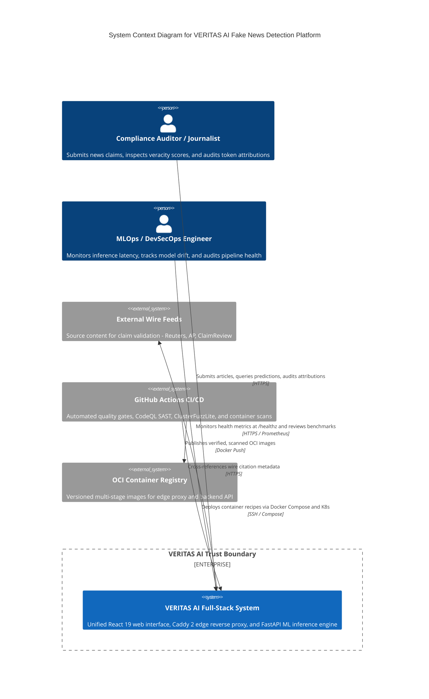
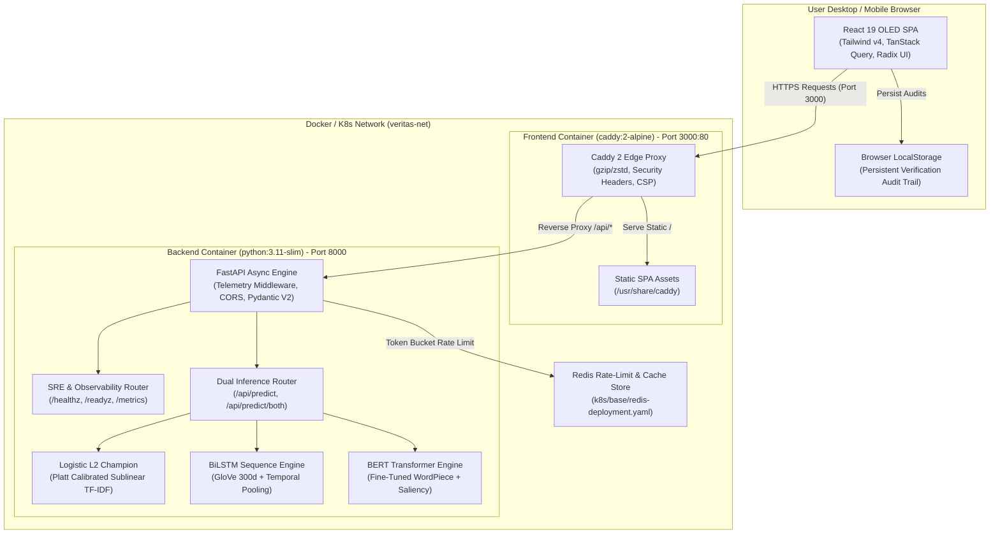
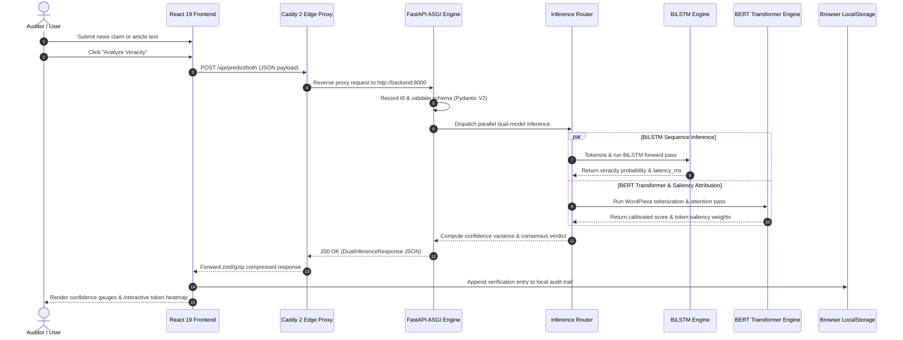
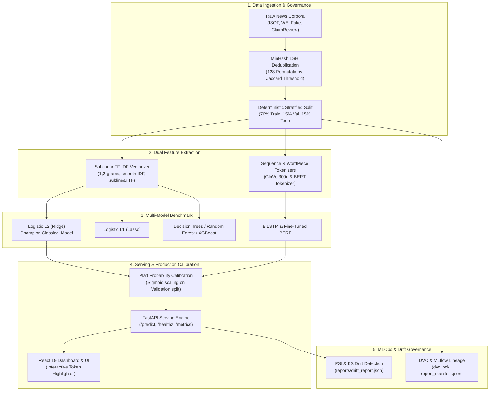
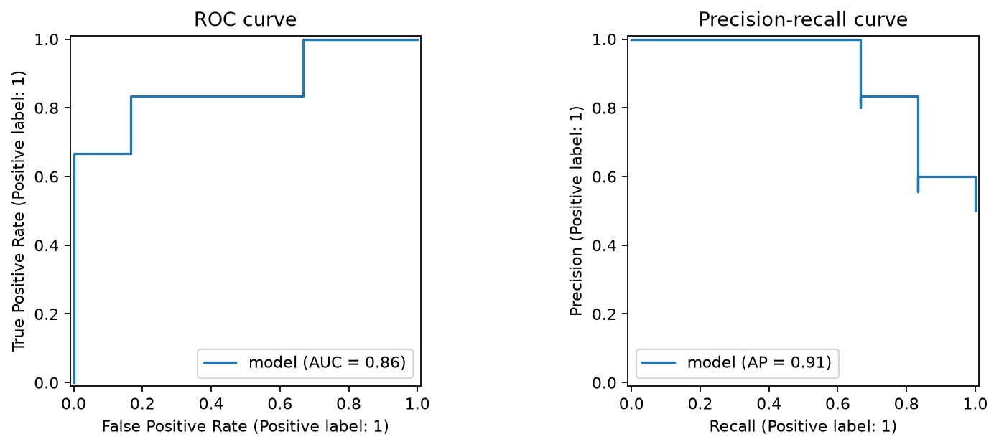
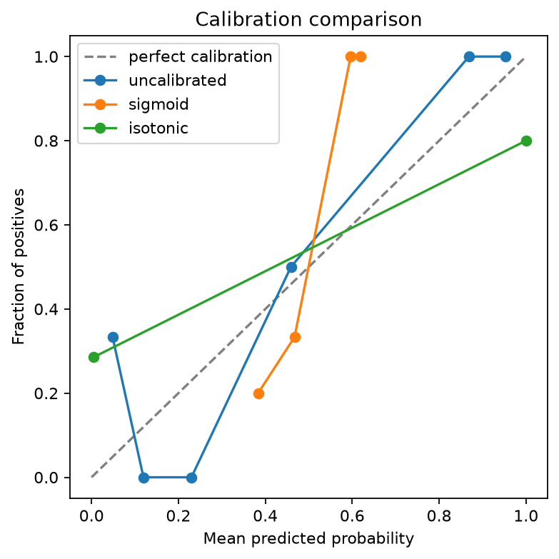
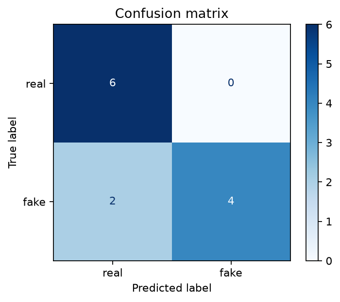
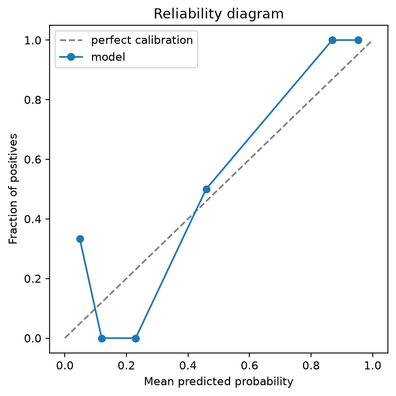
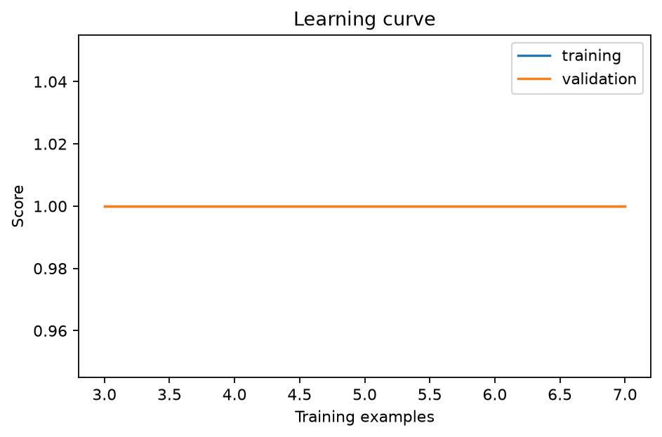
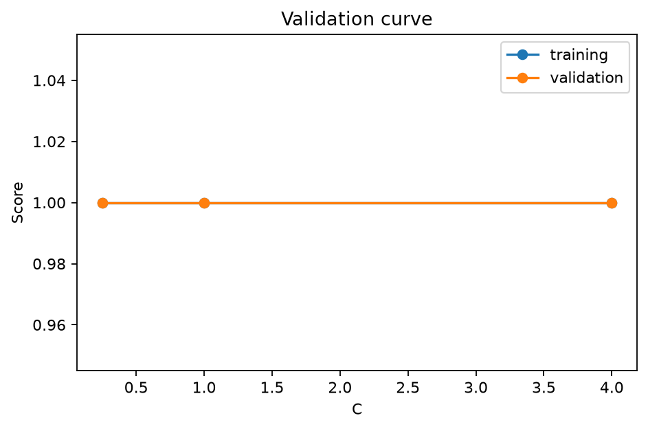

<div align="center">

# 🛡️ VERITAS AI
### Production-Grade Fake News Detection & Explainability Platform Using Classical NLP, BiLSTM & BERT Transformers

[](https://github.com/tejaswin-amara/Fake-News-Detection-Using-NLP-LSTM-and-BERT-Transformer-Models/actions/workflows/ci.yml)
[](https://github.com/tejaswin-amara/Fake-News-Detection-Using-NLP-LSTM-and-BERT-Transformer-Models/actions/workflows/codeql.yml)
[](https://github.com/tejaswin-amara/Fake-News-Detection-Using-NLP-LSTM-and-BERT-Transformer-Models/actions/workflows/clusterfuzzlite.yml)
[](https://github.com/tejaswin-amara/Fake-News-Detection-Using-NLP-LSTM-and-BERT-Transformer-Models/actions/workflows/fuzz.yml)
[](https://github.com/tejaswin-amara/Fake-News-Detection-Using-NLP-LSTM-and-BERT-Transformer-Models/actions/workflows/performance-smoke.yml)
[](https://github.com/tejaswin-amara/Fake-News-Detection-Using-NLP-LSTM-and-BERT-Transformer-Models/actions/workflows/scorecards.yml)
[](https://github.com/tejaswin-amara/Fake-News-Detection-Using-NLP-LSTM-and-BERT-Transformer-Models/actions/workflows/secret-scan.yml)
[](https://github.com/tejaswin-amara/Fake-News-Detection-Using-NLP-LSTM-and-BERT-Transformer-Models/actions/workflows/deploy-pages.yml)


[](./LICENSE)

[**Overview**](#-1-executive-overview) •
[**Architecture**](#-3-system--ml-architecture) •
[**Model Zoo & Benchmarks**](#-4-model-zoo--evaluation-diagnostics) •
[**Quick Start**](#-7-quick-start--deployment) •
[**API Reference**](#-6-api-specification--serving-contracts) •
[**Documentation Hub**](#-10-engineering-documentation-hub)

</div>

---

## 📌 1. Executive Overview

**VERITAS AI** is an end-to-end, enterprise-hardened misinformation detection, model benchmarking, and token-level explainability platform. It unifies a reproducible **DVC + MLflow machine learning pipeline** (`src/`) with a low-latency **FastAPI dual-inference backend** (`backend/`), an **OLED-optimized React 19 analytical dashboard** (`frontend/`), and **Kubernetes Kustomize** cloud-native manifests (`k8s/`).

Unlike standalone notebook experiments, VERITAS AI enforces strict **data leakage prevention**, **post-hoc probability calibration**, **statistical drift monitoring**, and **zero-trust DevSecOps gates** across every stage of the lifecycle.

---

## ✨ 2. Key Platform Capabilities

| Pillar | Capabilities & Engineering Highlights |
| :--- | :--- |
| 🧠 **Multi-Paradigm NLP Engine** | Benchmarks **L2/L1 Logistic Regression**, **Decision Trees**, **Random Forest**, **XGBoost**, **Unsupervised Clustering (K-Means/GMM/SVD)**, **Bidirectional LSTM (GloVe 300d)**, and **Fine-Tuned BERT (`bert-base-uncased`)** with ONNX runtime export support (`scripts/export_onnx.py`). |
| 🔬 **Leakage-Safe Data Governance** | Automated ingestion of **ISOT**, **WELFake**, and **ClaimReview** datasets (`src/data/`), featuring **128-permutation MinHash LSH near-duplicate elimination** (`src/features/minhash.py`) before deterministic `70% / 15% / 15%` stratified splitting (`data/processed/split_manifest.json`). |
| 🎯 **Calibrated Veracity & Explainability** | Post-hoc **Platt Sigmoid Scaling** reduces Expected Calibration Error (ECE) and Brier score (`reports/calibration_report.json`), paired with **token-level saliency heatmaps** and differential model variance gauges. |
| 🖥️ **React 19 OLED Analytical SPA** | 10+ specialized views (`AnalyzePage`, `ModelComparisonPage`, `ExplainabilityPage`, `EvaluationPage`, `UnsupervisedPage`, `DriftPage`, `HistoryPage`, `HealthPage`, `ApiKeysPage`) powered by **React 19, Tailwind CSS v4, Radix UI, TanStack Query, tRPC, and Drizzle ORM** behind a **Caddy 2** edge proxy. |
| 🛡️ **Zero-Trust DevSecOps & SRE** | Hardened non-root containers, **Kubernetes HPA + NetworkPolicy + Redis rate limiting** (`k8s/base/`), **Prometheus `/metrics`**, **Atheris & ClusterFuzzLite** continuous fuzzing (`fuzz/`), **CodeQL**, **Gitleaks**, **OpenSSF Scorecards**, and **manylinux Python 3.11 hash-locked dependencies**. |

---

## 🏗️ 3. System & ML Architecture

### 3.1 System Context Architecture (C4 Level 1)



### 3.2 Container Architecture (C4 Level 2)



### 3.3 End-to-End Inference & Token Attribution Flow



### 3.4 Data Pipeline Architecture



---

## 📊 4. Model Zoo & Evaluation Diagnostics

### 4.1 Implemented Model Families

| Model Family | Implementation Path | Feature Representation | Role in Platform |
| :--- | :--- | :--- | :--- |
| **Logistic Regression (L2 Ridge)** | `src/models/classical.py` / `artifacts/models/logistic_l2.joblib` | Sublinear TF-IDF (`1,2`-grams) + Platt Scaling | Fast, calibrated baseline & classical champion (`reports/champion_model.json`) |
| **Logistic Regression (L1 Lasso)** | `src/models/classical.py` | Sparse Sublinear TF-IDF (`1,2`-grams) | Feature selection & sparse linear benchmark (`reports/linear_models_comparison.json`) |
| **Tree Ensembles (DT / RF / XGBoost)** | `src/models/classical.py` | TF-IDF + Lexical Metadata Features | Non-linear tabular/lexical benchmark (`reports/tree_models_comparison.json`) |
| **Unsupervised (K-Means / GMM / SVD)** | `src/models/unsupervised.py` | Latent Semantic Analysis + Stylometric Features | Blind cluster purity & topic structure discovery (`reports/unsupervised_analysis.json`) |
| **Bidirectional LSTM (BiLSTM)** | `src/models/lstm.py` / `backend/app/models/lstm.py` | Pre-trained 300d GloVe Embeddings | Sequential recurrence & temporal dependency capture |
| **Fine-Tuned BERT Transformer** | `src/models/bert.py` / `backend/app/models/bert.py` | WordPiece Subword Tokens (`bert-base-uncased`) | Bidirectional self-attention & token saliency attribution |

### 4.2 Visual Evaluation Gallery

All evaluation curves and calibration diagnostics are automatically generated by `src/evaluate.py` and `scripts/generate_reports.py`:

| ROC & Precision-Recall Curves | Probability Calibration Comparison |
| :---: | :---: |
|  |  |
| **Held-Out Confusion Matrix** | **Reliability & Confidence Diagram** |
|  |  |
| **Sample Complexity Learning Curve** | **Hyperparameter Validation Curve** |
|  |  |

---

## 🖥️ 5. Frontend OLED SPA & Analytical Workbench

Located in `frontend/`, the web client is built with **React 19, TypeScript, Vite, Tailwind CSS v4, Radix UI, TanStack React Query, tRPC, and Drizzle ORM**:

* **Dual-Model Inference & Comparison (`AnalyzePage`, `ModelComparisonPage`)**: Side-by-side execution of BiLSTM and BERT models with a **Differential Confidence Gauge** (`DifferentialConfidenceGauge.tsx`) that flags cross-model divergence.
* **Token-Level Explainability (`ExplainabilityPage`)**: Interactive **Token Heatmap** (`TokenHighlighter.tsx`, `SaliencyPopover.tsx`, `WeightScale.tsx`) highlighting lexical triggers driving fake vs. real classifications.
* **Benchmarks & Telemetry Hub (`EvaluationPage`, `BenchmarksHub.tsx`)**: Interactive `MetricsRadar`, `ROCChart`, `LossGraph`, `ConfusionMatrix`, and `ComparativeMetricsTable` components.
* **Drift & Unsupervised Explorer (`DriftPage`, `UnsupervisedPage`)**: Monitors Population Stability Index (PSI) and Kolmogorov-Smirnov (KS) feature drift alongside unsupervised topic clusters.
* **Audit Trail & Export (`HistoryPage`, `ExportModal.tsx`)**: Persistent client/server verification log with JSON and CSV compliance export.

---

## 🔌 6. API Specification & Serving Contracts

The platform exposes OpenAPI 3.1-validated endpoints (linted via Spectral in `backend/.spectral.yaml` and documented in `backend/openapi.json`):

| Method | Endpoint | Service | Description |
| :--- | :--- | :--- | :--- |
| `POST` | `/api/predict/both` | `backend/app/api/endpoints.py` | Runs parallel **BiLSTM + BERT** inference, returning dual veracity scores, variance, and token attributions |
| `POST` | `/api/predict/bert` | `backend/app/api/endpoints.py` | Executes single-model **BERT Transformer** inference with attention saliency weights |
| `POST` | `/api/predict/lstm` | `backend/app/api/endpoints.py` | Executes single-model **BiLSTM** sequence inference |
| `POST` | `/predict` | `src/serving/app.py` | Champion model inference endpoint with Redis token-bucket rate limiting (`src/serving/rate_limiter.py`) |
| `GET` | `/healthz` / `/readyz` | Both Services | Kubernetes liveness and readiness probes |
| `GET` | `/metrics` | `src/serving/app.py` | Prometheus telemetry scrape endpoint |

### Example Request (`POST /api/predict/both`)

```bash
curl -X POST "http://localhost:8000/api/predict/both" \
  -H "Content-Type: application/json" \
  -d '{
    "text": "Federal Reserve announces benchmark interest rate decision following monthly FOMC policy meeting in Washington."
  }'
```

---

## 🚀 7. Quick Start & Deployment

### 7.1 Option A: Full-Stack Docker Compose (Recommended)

```bash
# 1. Clone the repository
git clone https://github.com/tejaswin-amara/Fake-News-Detection-Using-NLP-LSTM-and-BERT-Transformer-Models.git
cd Fake-News-Detection-Using-NLP-LSTM-and-BERT-Transformer-Models

# 2. Initialize environment configuration
cp .env.example .env

# 3. Build and launch Frontend (Caddy 2 + React 19 on :3000) & Backend (FastAPI on :8000)
docker compose up --build -d

# 4. Verify container health
curl -fsSL http://localhost:8000/healthz
```

* **React 19 Web Application**: `http://localhost:3000`
* **FastAPI Interactive Swagger UI**: `http://localhost:8000/docs`
* **Development / Dashboard Compose Profiles**: Use `docker-compose.dev.yml` for hot-reloading or `docker-compose.dashboard.yml` for dashboard-isolated deployment.

### 7.2 Option B: Reproducible DVC & ML Pipeline Execution

```bash
# Create a Python 3.11 virtual environment and install locked dependencies
python3.11 -m venv .venv
source .venv/bin/activate
pip install -r requirements.txt

# Execute the complete deterministic pipeline (Ingestion -> Dedup -> Train -> Evaluate -> Reports)
bash scripts/run_pipeline.sh

# Or reproduce individual stages via DVC
dvc repro

# Export trained deep learning models to ONNX Runtime
python scripts/export_onnx.py
```

### 7.3 Option C: Local Frontend & Backend Development

**Terminal 1 — FastAPI Inference Backend:**
```bash
uvicorn backend.app.main:app --reload --host 0.0.0.0 --port 8000
```

**Terminal 2 — React 19 Vite SPA:**
```bash
cd frontend
pnpm install
pnpm dev
```

### 7.4 Option D: Kubernetes Cloud-Native Deployment (`k8s/base`)

```bash
# Validate and apply Kustomize manifests (Namespace, Deployment, HPA, Ingress, NetworkPolicy, Redis, ServiceMonitor)
kubectl apply -k k8s/base/
kubectl get pods -n veritas-ai
```

---

## 🧪 8. Testing, Fuzzing & Quality Gates

The repository enforces automated verification across unit, contract, accessibility, stress, security, and fuzzing layers:

```bash
# 1. Run full Python test suite (unit, ingestion, serving, SRE, zero-trust, security hardening)
pytest -v --cov=src --cov=backend

# 2. Run production readiness & severity gates
python scripts/verify_production_readiness.py
python scripts/source_audit.py

# 3. Run Frontend Vitest unit tests, Biome linter & Playwright E2E / Accessibility tests
cd frontend
pnpm check
pnpm test
pnpm exec playwright test

# 4. Run Atheris ClaimReview fuzzer locally
python fuzz/atheris_claimreview_fuzzer.py fuzz/corpus/ -max_total_time=30
```

### CI/CD Automation Matrix (`.github/workflows/`)

| Workflow | File | Purpose |
| :--- | :--- | :--- |
| **Continuous Integration** | `ci.yml` | Runs Python/Frontend linting, type-checking, unit tests, coverage, and build verification |
| **CodeQL Analysis** | `codeql.yml` | Static Application Security Testing (SAST) across Python and TypeScript/JavaScript |
| **ClusterFuzzLite** | `clusterfuzzlite.yml` | Continuous sanitizer-instrumented fuzzing on pull requests and batch runs |
| **Atheris Fuzzing** | `fuzz.yml` | Dedicated fuzzing for text parsing (`tests/fuzz/fuzz_text_parsing.py`) and ClaimReview schemas |
| **Performance Smoke** | `performance-smoke.yml` | k6 API latency and throughput smoke testing (`tests/performance/api_smoke.js`) |
| **Secret Scanning** | `secret-scan.yml` | Gitleaks secret detection across commit history (`.gitleaks.toml`) |
| **OpenSSF Scorecards** | `scorecards.yml` | Supply-chain security posture and branch protection auditing |
| **GitHub Pages Deploy** | `deploy-pages.yml` | Publishes static showcase and benchmark reports (`pages/`) |
| **Release Automation** | `release.yml` | Semantic release packaging and container artifact publishing |
| **PR Labeler** | `labeler.yml` | Automated PR categorization based on modified file paths |

---

## 📂 9. Repository Topology

```text
Fake-News-Detection-Using-NLP-LSTM-and-BERT-Transformer-Models/
├── .clusterfuzzlite/          # ClusterFuzzLite Dockerfile, build.sh & project.yaml
├── .devcontainer/             # VS Code DevContainer configuration
├── .dvc/                      # Data Version Control configuration
├── .github/                   # GitHub Actions workflows (10), Dependabot, CODEOWNERS & templates
├── artifacts/models/          # Serialized champion model (logistic_l2.joblib) & package_manifest.json
├── backend/                   # FastAPI Dual-Engine Inference Service
│   ├── app/                   # API endpoints, Pydantic v2 schemas, BiLSTM & BERT inference engines
│   ├── tests/                 # Backend API contract tests (test_api.py)
│   ├── Dockerfile             # Hardened multi-stage backend image
│   └── openapi.json           # OpenAPI 3.1 contract specification
├── configs/                   # Declarative YAML configs (default, dataset, models, evaluation)
├── data/                      # Raw, external & stratified processed splits (split_manifest.json)
├── deploy/                    # Production release contract environment templates
├── docs/                      # 25 numbered engineering specs, ADRs, runbooks & security guides
├── frontend/                  # React 19 + TypeScript + Tailwind v4 SPA & tRPC/Drizzle server
│   ├── client/                # Dashboard layouts and 10+ analytical page views
│   ├── src/                   # Feature modules (inference, explainability, comparison, benchmarks, history)
│   ├── server/                # Express/tRPC routers, Drizzle DB integration & FastAPI proxy client
│   ├── e2e/                   # Playwright E2E, accessibility, audit-trail & explainability specs
│   ├── Caddyfile              # Caddy 2 reverse proxy, compression & CSP security headers
│   └── Dockerfile             # Multi-stage Node build + Caddy 2 Alpine edge image
├── fuzz/                      # Atheris ClaimReview fuzzer & seed corpus
├── k8s/                       # Kubernetes Kustomize base manifests & Prometheus ServiceMonitor schemas
├── notebooks/                 # Reproducible notebooks (01_eda, 02_unsupervised_analysis, 03_model_evaluation)
├── pages/                     # Static showcase & pre-built SPA bundle for GitHub Pages
├── reports/                   # JSON evaluation reports, drift reports, MLflow runs & PNG diagnostic plots
├── requirements/              # Reproducible manylinux_2_28 Python 3.11 hash-locked requirement files
├── scripts/                   # Automation scripts (pipeline, ONNX export, MLflow init, readiness gates)
├── src/                       # Core ML package (data, features, models, evaluation, monitoring, serving)
├── tests/                     # 18+ comprehensive Python test suites + k6 performance & fuzz harnesses
├── docker-compose.yml         # Production multi-container orchestration
├── dvc.yaml                   # DVC pipeline DAG definition
└── pyproject.toml             # Python project metadata, Ruff, Pytest & Mypy configuration
```

---

## 📚 10. Engineering Documentation Hub

The `docs/` directory contains a complete software and ML engineering specification suite:

<details>
<summary><strong>📖 Click to expand all 25 Engineering Specifications, ADRs & Runbooks</strong></summary>

### Core Engineering & ML Specifications
* [`00_PROJECT_MASTER_PLAN.md`](./docs/00_PROJECT_MASTER_PLAN.md) — End-to-end master execution plan
* [`01_PROJECT_CHARTER.md`](./docs/01_PROJECT_CHARTER.md) — Scope, objectives, and stakeholder charter
* [`02_REQUIREMENTS.md`](./docs/02_REQUIREMENTS.md) — Functional and non-functional system requirements
* [`03_ARCHITECTURE.md`](./docs/03_ARCHITECTURE.md) & [`ARCHITECTURE.md`](./ARCHITECTURE.md) — C4 architectural blueprints
* [`04_DEVELOPMENT_WORKFLOW.md`](./docs/04_DEVELOPMENT_WORKFLOW.md) — Branching, Lefthook pre-commit hooks, and CI conventions
* [`05_MVP_IMPLEMENTATION_PLAN.md`](./docs/05_MVP_IMPLEMENTATION_PLAN.md) — Phased MVP delivery milestones
* [`06_ML_METHODOLOGY.md`](./docs/06_ML_METHODOLOGY.md) & [`mathematical_formulation.md`](./docs/mathematical_formulation.md) — Mathematical derivations for TF-IDF, Logistic Regression, Platt Scaling, BiLSTM, and BERT
* [`07_EVALUATION_PROTOCOL.md`](./docs/07_EVALUATION_PROTOCOL.md) — Metrics, calibration, and statistical significance testing
* [`08_UNSUPERVISED_PLAN.md`](./docs/08_UNSUPERVISED_PLAN.md) — Clustering, dimensionality reduction, and topic modeling protocol
* [`09_API_SPEC.md`](./docs/09_API_SPEC.md) — REST & tRPC endpoint contracts
* [`10_DATASET_CARD.md`](./docs/10_DATASET_CARD.md) & [`dataset_card.md`](./docs/dataset_card.md) — Dataset provenance, preprocessing, and split manifests
* [`11_MODEL_CARD.md`](./docs/11_MODEL_CARD.md) & [`model_cards.md`](./docs/model_cards.md) — Intended use, limitations, and subgroup fairness metrics
* [`12_EXPERIMENT_TRACKER_TEMPLATE.md`](./docs/12_EXPERIMENT_TRACKER_TEMPLATE.md) — MLflow run logging standard
* [`13_TESTING_STRATEGY.md`](./docs/13_TESTING_STRATEGY.md) & [`performance-testing.md`](./docs/performance-testing.md) — Unit, E2E, fuzz, and load testing strategy
* [`14_DEPLOYMENT_GUIDE.md`](./docs/14_DEPLOYMENT_GUIDE.md) & [`deployment.md`](./docs/deployment.md) — Container and K8s rollout procedures
* [`15_MLOPS_PLAN.md`](./docs/15_MLOPS_PLAN.md) — Drift detection, retraining triggers, and artifact lineage
* [`16_CAPSTONE_COMPLIANCE_MATRIX.md`](./docs/16_CAPSTONE_COMPLIANCE_MATRIX.md) & [`compliance_matrix.md`](./docs/compliance_matrix.md) — Requirement traceability matrix
* [`17_RISK_REGISTER.md`](./docs/17_RISK_REGISTER.md) — Technical and operational risk mitigation log
* [`18_DEMO_SCRIPT.md`](./docs/18_DEMO_SCRIPT.md) — Step-by-step live walkthrough guide
* [`19_CAPSTONE_REPORT_OUTLINE.md`](./docs/19_CAPSTONE_REPORT_OUTLINE.md) — Academic report structure
* [`20_DEVELOPER_CHECKLIST.md`](./docs/20_DEVELOPER_CHECKLIST.md) — Pre-release verification checklist
* [`21_GITHUB_REPO_STRUCTURE.md`](./docs/21_GITHUB_REPO_STRUCTURE.md) — Repository layout specification
* [`22_WEEKLY_EXECUTION_PLAN.md`](./docs/22_WEEKLY_EXECUTION_PLAN.md) — Sprint schedule
* [`23_SOURCE_GOVERNANCE.md`](./docs/23_SOURCE_GOVERNANCE.md) & [`sources.md`](./docs/sources.md) — Data source authenticity and SHA-256 verification
* [`24_DECISION_LOG.md`](./docs/24_DECISION_LOG.md) — Architectural Decision Records (ADRs)

### Security, SRE & Production Runbooks
* [`docs/security_hardening.md`](./docs/security_hardening.md) — Container, API, and dependency hardening controls
* [`docs/security/api-and-observability.md`](./docs/security/api-and-observability.md) — Zero-trust API telemetry
* [`docs/security/hash-lock-maintenance.md`](./docs/security/hash-lock-maintenance.md) — Supply-chain lockfile maintenance
* [`docs/deployment/production-readiness.md`](./docs/deployment/production-readiness.md) & [`production-rollout.md`](./docs/deployment/production-rollout.md)
* [`docs/runbooks/incident-response.md`](./docs/runbooks/incident-response.md) & [`rollback.md`](./docs/runbooks/rollback.md)

</details>

---

## 🤝 11. Contributing, Governance & License

* **Contributing**: Please review [`CONTRIBUTING.md`](./CONTRIBUTING.md) and [`CODE_OF_CONDUCT.md`](./CODE_OF_CONDUCT.md) before submitting pull requests.
* **Security Policy**: Report vulnerabilities privately per [`SECURITY.md`](./SECURITY.md).
* **Governance & Support**: Project stewardship and support channels are detailed in [`GOVERNANCE.md`](./GOVERNANCE.md) and [`SUPPORT.md`](./SUPPORT.md).
* **Citation**: If you use this platform or methodology in academic work, please cite it using [`CITATION.cff`](./CITATION.cff):

```bibtex
@software{amara_veritas_ai_2026,
  author       = {Amara, Tejaswin},
  title        = {{VERITAS AI: Fake News Detection Using NLP, LSTM, and BERT Transformer Models}},
  year         = {2026},
  url          = {https://github.com/tejaswin-amara/Fake-News-Detection-Using-NLP-LSTM-and-BERT-Transformer-Models},
  license      = {MIT}
}
```

Distributed under the **[MIT License](./LICENSE)**.
